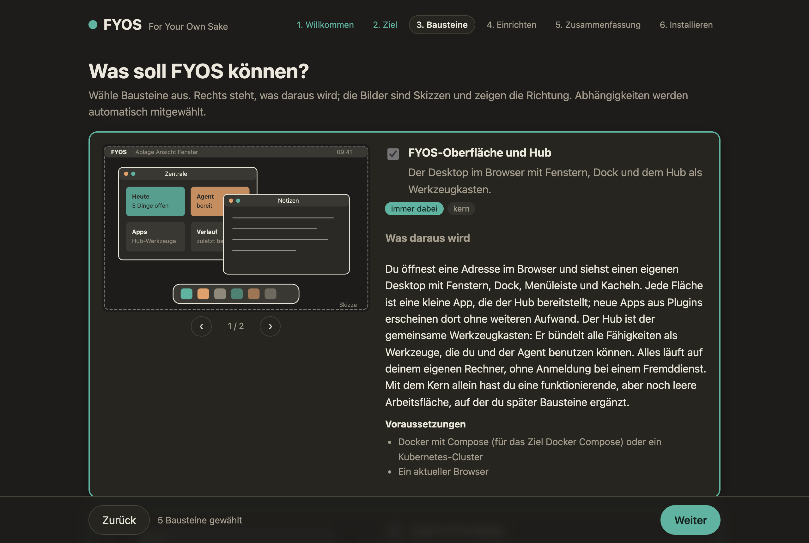

English: [README.en.md](README.en.md)

# FYOS — For Your Own Sake

Ein persönliches Betriebssystem im Browser, das auf einem eigenen Agenten aufbaut und ganz bei dir läuft: eine
Desktop-Shell mit Fenstern und Apps, ein MCP-Hub, der Werkzeuge und Oberflächen aus Plugins bündelt, und ein Agent
(eine Mod von OpenClaw), der mit diesen Werkzeugen arbeitet und vor schweren Schritten fragt.

Diese Distribution enthält nur Allgemeines. Was ein bestimmtes Zuhause, ein Konto oder eine Person braucht, kommt als
Plugin aus einem eigenen Repo.

```text
Plugins (je ein Repo)    fyos-plugin-…            persönlich, optional
fyos-os (dieses Repo)    web/  hub/  deploy/  installer/
fyos-agent (Grundlage)   Agentenverhalten als OpenClaw-Mod
OpenClaw (Upstream)      Basisbild per Digest
```

## Was hier liegt

| Ordner | Inhalt |
|---|---|
| [`web/`](web/README.md) | Desktop-Shell (Astro mit SolidJS): Fenster, Dock, Kacheln, Menüleiste; zeigt Hub-Apps (`ui://`) ohne eigenen Code |
| [`hub/`](hub/README.md) | MCP-Hub (Python-Paket `fyos-hub`, Modul `mcp_hub`): MCP unter `/mcp`, REST unter `/hub/*`, Plugins per Entry-Point |
| [`installer/`](installer/README.md) | Installer mit Web-Assistent, Textoberfläche und Kommandozeile; erklärt jeden Baustein mit Bildern |
| `deploy/compose/` | Einzelplatz mit Docker Compose (`docker-compose.yml`, `env.example`, `fyos.yaml`, `hub-config.yaml`) |
| `deploy/k8s/base/` | Kubernetes-Grundinstallation (Kustomize); Bilder und Namespace setzt ein Overlay |
| `tools/sauber.py` | Sauberkeitsprüfung: keine privaten Netze, Adressen, Geheimnisse oder verbotenen Wörter im Repo |
| `tools/doku_pruefen.py` | Doku-Abgleich: Links, genannte Pfade und feste Abschnitte der Markdown-Dateien stimmen mit dem Repo überein |
| `docs/` | [Architektur](docs/ARCHITEKTUR.md), [Hub-Vertrag](docs/HUB-VERTRAG.md), [Erweitern](docs/ERWEITERN.md) |

## Loslegen

Der bequeme Weg ist der Installer. Er fragt nach Bausteinen (Kern, Agent, Plugins), zeigt, was daraus wird, und
erzeugt die Auslieferung für Docker Compose oder Kubernetes.

```sh
pip install ./installer        # Python 3.11 oder neuer
fyos-install                   # Web-Assistent im Browser; --tui für die Textoberfläche
```



Alle Schritte mit Bildern: [`installer/README.md`](installer/README.md).

Ohne Installer, mit Docker Compose:

```sh
cd deploy/compose
cp env.example .env            # Bilder, Modell und Agent-Token eintragen
docker compose up -d           # danach http://localhost:8080
```

Die Bilder baut die CI dieses Repos (`<registry>/fyos-os/web`, `<registry>/fyos-os/hub`) und die von `fyos-agent`
(`<registry>/fyos-agent/openclaw`). Die Vorgaben zeigen auf die Beispieladresse `registry.example.com`, die sich nie
auflösen lässt: ohne eigene Registry bricht der Start sichtbar ab, statt fremde Bilder zu ziehen. Den Installer lenkt
`FYOS_REGISTRY=<host>/<besitzer>` auf die eigene Registry.

Als Modell dient jeder OpenAI-kompatible Anbieter (zum Beispiel ein llama.cpp-Server, Ollama oder vLLM), lokal oder im
eigenen Netz.

**Der erste Chat.** Das Agent-Fenster zeigt die Oberfläche des OpenClaw-Gateways. Beim ersten Öffnen fragt sie nach dem
Gateway-Token (`FYOS_AGENT_TOKEN` aus `.env`, in Kubernetes das Secret `fyos-agent-gateway`); der Browser merkt es sich.
Jeder neue Browser braucht danach einmal die Freigabe als Gerät, weil das Gateway ihn über die Shell als entfernten
Client sieht:

```sh
docker compose exec agent openclaw devices list              # Kubernetes: kubectl exec agent-0 -- openclaw devices list
docker compose exec agent openclaw devices approve <requestId>
```

Über reines http klappt das nur unter `localhost`. Im Netz braucht die Shell https, denn die Geräte-Identität erzeugt der
Browser nur in einem sicheren Kontext; sonst meldet das Gateway „control ui requires device identity“.

## Erweitern

Ein Plugin ist ein Python-Paket mit Entry-Point `mcp_hub.plugins`. Es kann Werkzeuge, eine Oberfläche, Skills für den
Agenten und einen Eintrag im Installer-Katalog mitbringen. Startpunkt ist das Repo `fyos-plugin-vorlage`; die ganze
Anleitung mit Beispielen steht in [`docs/ERWEITERN.md`](docs/ERWEITERN.md): Hub-Plugin, App, Skills, Agentenverhalten,
Shell, Katalog, Begleitdienste, Testen und Ausliefern.

**Pakete mit uv, der eigene Index zuerst.** Plugin-Pakete installiert FYOS mit [uv](https://docs.astral.sh/uv/) statt mit
pip: im Hub-Bild, im vom Installer erzeugten Dockerfile und im Muster-Plugin. Liegen die Plugins in einem eigenen
Paketindex, steht dessen Adresse per `--index` vor PyPI (als Bau-Argument `FYOS_INDEX_URL`; der Installer liest sie aus
`FYOS_PAKETINDEX`). Dazu steht `--index-strategy first-index` ausdrücklich im Befehl: uv nimmt ein Paket nur aus dem ersten
Index, der es führt. Ein Paket gleichen Namens auf PyPI kann so ein Plugin aus dem eigenen Index nicht verdrängen
(Dependency Confusion); mit `pip --extra-index-url` wäre das möglich, weil pip die höchste Version aus allen Indizes
nimmt. Die Version von uv ist in den Dockerfiles fest. Mehr dazu in [`docs/ERWEITERN.md`](docs/ERWEITERN.md), Abschnitt 10.3.

## Entwickeln

```sh
python3 tools/sauber.py .                                         # muss still sein
python3 tools/doku_pruefen.py                                     # Doku stimmt mit dem Repo überein
pip install -e "hub[test]" && python -m pytest hub/tests -q
pip install -e "installer[test]" && python -m pytest installer/tests -q
cd web && npm ci && npx vitest run && npx astro build
```

Die Befehle zum Entwickeln und Testen dieses Repos nutzen pip, weil es überall da ist; mit `uv pip install` laufen sie
genauso.

Die CI (`.gitea/workflows/ci.yml`) prüft jeden Push genauso. Auf `main` lädt sie `fyos-hub` als Entwicklungsstand
(`X.Y.Z.devN`) in den Paketindex des Git-Servers und baut die Bilder `web` und `hub` mit den Tags `main` und Commit.

Auf GitHub laufen dieselben Prüfungen als `.github/workflows/tests.yml`, dazu ein Geheimnis-Scan mit gitleaks. Auf einen
Tag `v*` veröffentlicht `.github/workflows/pypi.yml` die Pakete `fyos-hub` und `fyos-installer` auf PyPI (Trusted
Publishing, ohne gespeichertes Token) und `.github/workflows/bilder.yml` baut die Bilder nach ghcr.io.

Den Doku-Abgleich fährt die CI zusätzlich jede Nacht und auf Knopfdruck (`.gitea/workflows/doku-nachts.yml`). Er prüft
alle Markdown-Dateien: Links und Anker, Pfade in Code-Schnipseln (`web/src/lib/hub.ts`) und die festen Abschnitte der
READMEs. Was die Doku nennt und nicht in diesem Repo liegt (Dateien von `fyos-agent` oder aus Plugin-Repos, Beispiele,
Dateien, die erst im Betrieb entstehen), steht mit Grund in `.doku/ausserhalb.txt`.

## Lizenz

FYOS OS steht unter der Apache License, Version 2.0 (SPDX-Kennung `Apache-2.0`).

Copyright 2026 sirfyyn and FYOS CONTRIBUTORS <!-- sauber: ok -->

Der vollständige Lizenztext steht in [`LICENSE`](LICENSE), der Urheberhinweis in [`NOTICE`](NOTICE).
