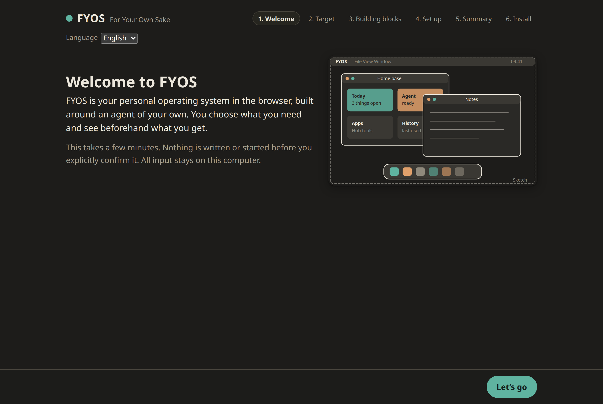
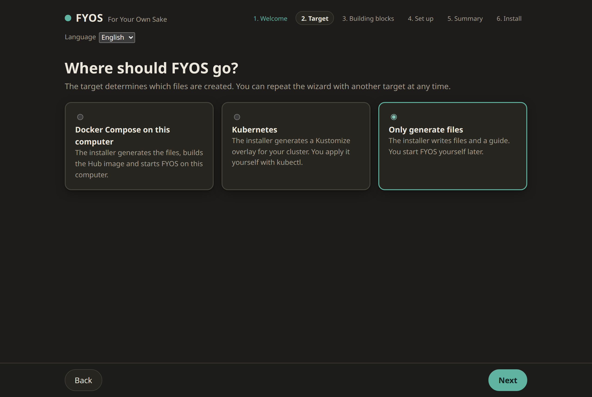
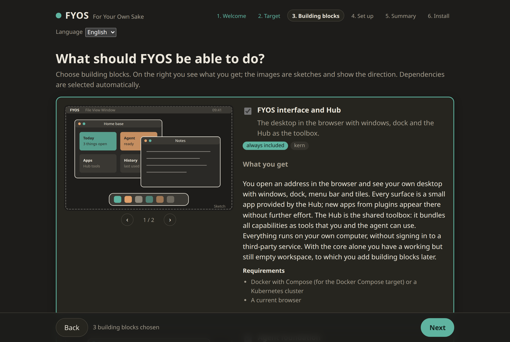
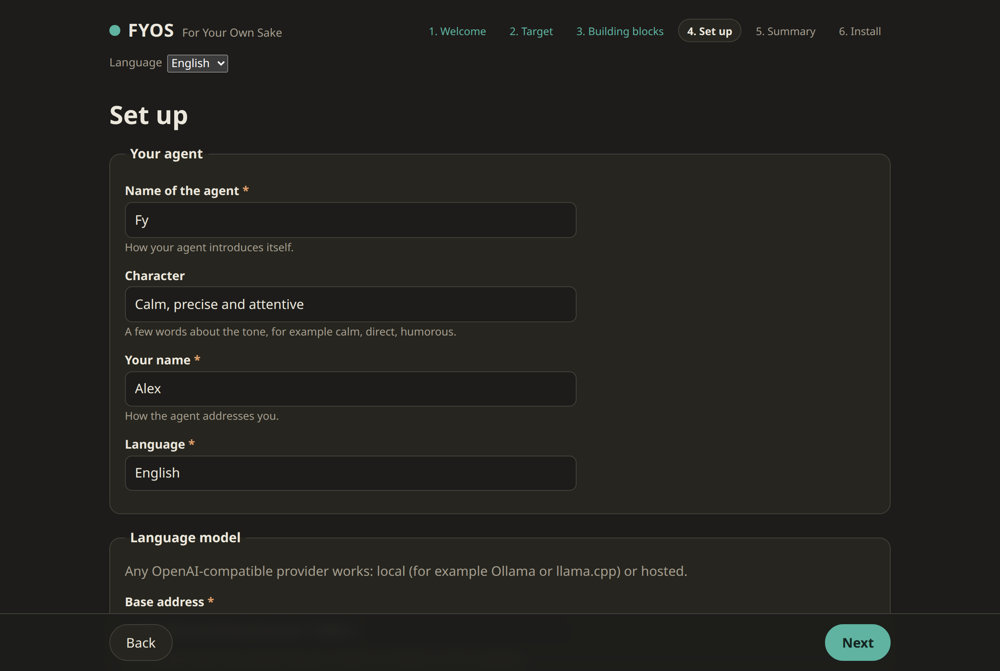
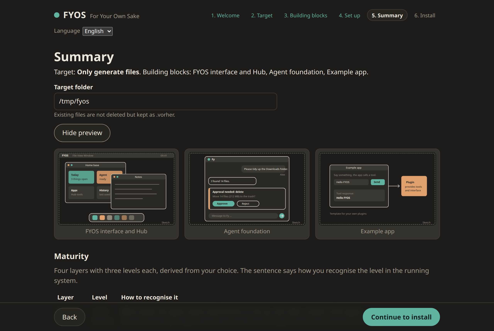
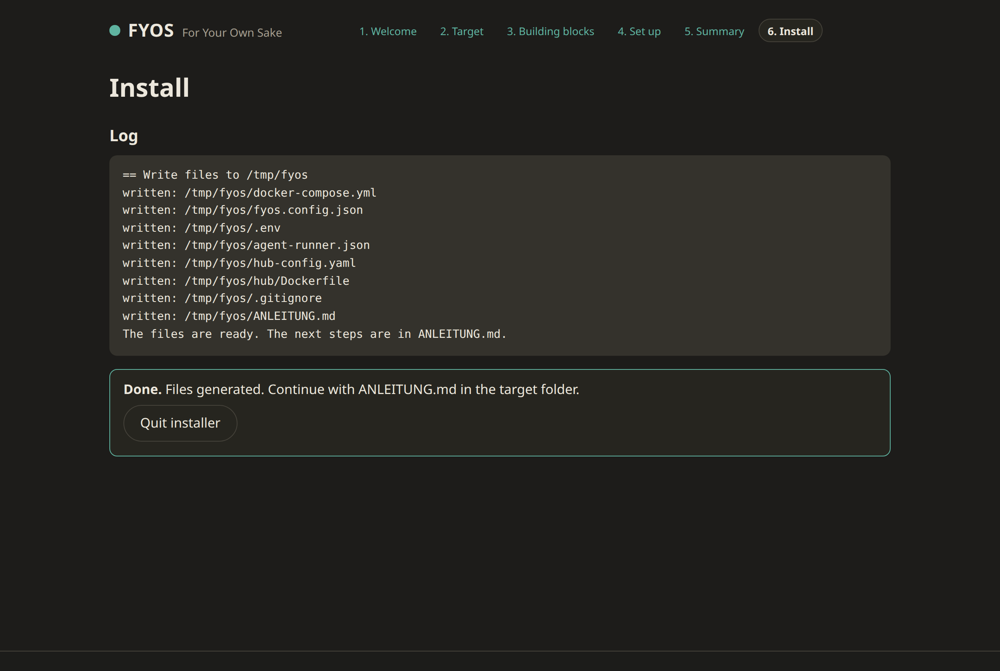

# FYOS installer

The installer of the distribution **FYOS — For Your Own Sake**: a selection of building blocks that explains on screen
(with pictures) what they turn into, and then generates the delivery (Docker Compose or Kubernetes).

```sh
pip install ./installer                 # Python 3.11 or newer
pip install "./installer[tui]"          # optional: text interface
pip install "./installer[tui,bilder]"   # optional: screenshots (PNG/JPG) in the terminal
```

## Three ways to use it

### 1. Web assistant (default)

```sh
fyos-install
```

Starts a server on `127.0.0.1` only (random port, access token in the link) and opens the browser. Works offline,
without a CDN. Steps: welcome, target, building blocks, setup, summary, install (live log). Keyboard use: Tab, space
(choose a building block), arrow keys in the picture gallery, Enter for next. `--kein-browser` only prints the link,
`--port N` sets the port.

| Step | Picture |
|---|---|
| Welcome |  |
| Choose the target |  |
| Building blocks with picture gallery and "What it turns into" |  |
| Setup (agent, model, fields of the building blocks) |  |
| Summary with a preview of what will be created |  |
| Install with live log (here the target "files only") |  |

The screenshots still show the German interface.

The pictures in the building block gallery are sketches under `fyos_installer/bilder/` (for example
[kern-1.svg](fyos_installer/bilder/kern-1.svg), [agent-1.svg](fyos_installer/bilder/agent-1.svg),
[finanzen-1.svg](fyos_installer/bilder/finanzen-1.svg), [haus-1.svg](fyos_installer/bilder/haus-1.svg)); if a `.png`
of the same name lies next to one, the installer shows that.

API (every call needs the token): `GET /api/katalog`, `POST /api/plan`, `POST /api/installieren`,
`GET /api/protokoll` (server-sent events).

### 2. Text interface

```sh
fyos-install --tui
```

The same steps with Textual. Keys: `n` next, `b` back, `q` quit (`Ctrl+n` / `Ctrl+b` also in a text field).
`textual-image` (extra `bilder`) shows PNG/JPG pictures; SVG sketches appear as a text description with their path.
Without Textual a message with the matching `pip` command appears.

### 3. Without an interface

```sh
fyos-install --auswahl kern,agent,finanzen --ziel compose --antworten antworten.yaml --verzeichnis ./fyos --trocken
fyos-install --auswahl kern,agent --ziel k8s --verzeichnis ./fyos-k8s --ja
```

`--ziel compose|k8s|dateien`; `--trocken` shows files and commands and writes nothing; `--ja` does not ask; without a
terminal `--ja` is required. Dependencies and required building blocks are added. `--liste` shows the catalog.
`--abnahme ADDRESS` runs only the [acceptance check](#acceptance-check) against a running installation.

Exit codes: `0` good, `1` installation or start failed, `2` wrong input, `3` FYOS is running, but the acceptance check
did not pass.

`antworten.yaml` (everything optional, defaults see `erzeugen.py`):

```yaml
persona: {agent_name: Fy, wesen: calm and direct, besitzer_name: Alex, sprache: English}
modell: {basis_url: "http://host.docker.internal:11434/v1", name: "mein-modell", schluessel: ""}
felder:
  kern: {port: 8080}
  haus: {ha_url: "http://homeassistant.example.com:8123", ha_token: "…"}
optionen: {plugin_quelle: "https://git.example.com/fyos", namespace: fyos}
stufen: {termine: ausbau, postfach: grund}     # tier per capability, see below
```

Defaults from the environment:

| Variable | Effect |
|---|---|
| `FYOS_PAKETINDEX` | PyPI-compatible index (for example `https://git.example.com/api/packages/org/pypi/simple`); plugins are installed by package name, the index goes into the hub Dockerfile as `--build-arg FYOS_INDEX_URL` and comes before PyPI there |
| `FYOS_PLUGIN_QUELLE` | Git address of the plugin repos (`optionen.bezug: git`) |
| `FYOS_REGISTRY` | for example `registry.example.com/org`; results in `<reg>/fyos-os/web:main`, `<reg>/fyos-os/hub:main`, `<reg>/fyos-agent/runner:main` |
| `FYOS_BILD_TAG` | tag of all images instead of `v<version>` (without `FYOS_REGISTRY`) or `main` (with it), for example `latest` |

Without `FYOS_REGISTRY`, interface, Hub and agent foundation come from the published images at `ghcr.io/sirfyyn`, at <!-- sauber: ok -->
the installer's version (installer 0.3.0 → tag `v0.3.0`; the runner image stays at `v0.2.1` until fyos-agent 0.3.0 is
released). Only the hub image with the chosen plugins (`hub_bild_k8s`, target Kubernetes) you build yourself; it needs a registry of your own, otherwise the plan
points this out. `optionen.bezug` is `index` (default) or `git`; if only a plugin source is set, `git` applies. The
images (`bild_web`, `hub_bild`, `bild_agent`, `hub_bild_k8s`) can be edited in the answers and in the assistant.

#### Why uv, and why your own index takes precedence

The generated hub Dockerfile installs the plugin packages with `uv pip install` instead of `pip`. Your own package
index comes as the build argument `FYOS_INDEX_URL` (Compose passes `FYOS_PAKETINDEX` from the `.env` through for this,
for Kubernetes it is in the build command) and goes before PyPI through `--index`. In addition, `--index-strategy
first-index` is set explicitly in the command: uv takes a package only from the first index that carries it. A package
of the same name on PyPI therefore cannot displace your own (dependency confusion). With `pip --extra-index-url`, by
contrast, pip would take the highest version from all indexes, and a foreign package with a higher version number would
win. `unsafe-best-match` belongs nowhere in the command; a test enforces this. The version of uv is pinned (`UV_BILD`
in `fyos_installer/erzeugen.py`, the same as in the distribution's hub image; a test keeps both equal). The earlier
build argument name `PIP_EXTRA_INDEX_URL` is gone: uv does not read it. An old build command with this name therefore
leaves your own index out (Docker warns about the unused build argument); the build then does not find packages that
live only in your own index and fails. If your own index itself is unreachable, uv fails as well instead of falling
back to PyPI.

## The agent

The agent is the **runner** (`fyos-agent/runner`, long-running on pi-durable, port 18438), for Docker Compose as for
Kubernetes. The interface talks to it through `/api/agent` and authenticates with `FYOS_AGENT_TOKEN` (in the runner's
container it is called `FYOS_RUNNER_TOKEN`); the model comes from `FYOS_MODELL_*`. The installer writes its
configuration to `agent-runner.json`, with the built-in daily rhythm turned off (`"takt": {"an": false}`). Since 0.2.1
there is no choice of agent any more; an old answer `optionen.agent` is skipped with a hint.

Chat channels (Telegram, WhatsApp, Matrix) as building blocks no longer exist. The runner sets up Matrix as a route for
approval messages itself: `pi_durable.freigabe_meldung.kanaele` in `agent-runner.json` (see
`fyos-agent/runner/README.md`).

## What gets created

Compose (`compose`, `dateien`): `docker-compose.yml` (Hub with `build: ./hub`), `.env` (secrets, permissions 0600),
`agent-runner.json` (the runner's configuration), `hub-config.yaml` (the Hub's format, plugins by entry point name),
`hub/Dockerfile` (`FROM <hub image>` plus `uv pip install` of the plugin sources), `.gitignore`, `ANLEITUNG.md`. With
`compose`, `docker compose build`, `up -d` and a health check (web `/`, hub `/health`) follow.

Kubernetes (`k8s`): a Kustomize overlay with `kustomization.yaml` (base `deploy/k8s/base` as a path or Git URL,
`optionen.k8s_basis`), ConfigMaps for `agent-runner.json` (`fyos-agent-config`) and the Hub configuration,
`secrets.yaml` (0600: `fyos-modell`, `fyos-agent-token`, plugin secrets) and `secrets.example.yaml`, `hub/Dockerfile`,
`ANLEITUNG.md`. The user applies it with `kubectl`. Existing files are backed up as `<name>.vorher`.

The generated guide `ANLEITUNG.md` and the texts in the installer's interface are still German.

## Tier per capability

Five capabilities come in two variants: tickets, appointments, reading mail, sending mail and documents. The **basic
tier** needs no service of its own (a store in the Hub, a CalDAV account or ICS subscription, an IMAP mailbox); the
**extended tier** needs one (ticket service, appointment service, mailbox service, Listmonk, Paperless-ngx) that the
Hub reaches through an address. You choose the tier **per capability**; without a choice the default by deployment type
applies:

| Capability (`--stufe` name) | Basic tier | Extended tier (variable) | Compose | Kubernetes |
|---|---|---|---|---|
| Tickets (`vorgaenge`) | store in the Hub | ticket service (`FYOS_VORGAENGE_URL`) | basic | extended |
| Appointments (`termine`) | CalDAV and ICS directly | appointment service (`FYOS_TERMINE_URL`) | basic | extended |
| Read mail (`postfach`) | IMAP directly | mailbox service (`FYOS_POSTFACH_URL`) | basic | extended |
| Send mail (`post`) | — | Listmonk (`FYOS_POST_URL`) | extended | extended |
| Documents (`dokumente`) | folder store (does not exist yet) | Paperless-ngx (`FYOS_DOKUMENTE_URL`) | extended | extended |

The values for `--stufe` are `grund` (basic), `ausbau` (extended) and `aus` (off).

- **Choosing:** in the web assistant and in the text interface every building block with a capability has a choice
  (preselected is the target's default); without an interface `--stufe termine=ausbau` (repeatable) or `stufen:` in the
  answers file; the option wins. `--liste` shows the capabilities with tiers and defaults. Where it fits, there is also
  the choice **off**: set up none of it, and the capability honestly reports "not set up". Tickets cannot be turned off.
  Where there is no basic tier, or none has been built yet, extended and off remain; whoever asks for it anyway gets an
  error message.
- **Effect:** only the fields of the chosen tier are asked for and written. With the basic tier no service and no
  service address is created; the plugin takes the direct route. With the extended tier the address is in the Hub's
  environment. The installer does **not ship** the extended-tier services **yet**: the plan writes the line
  (`FYOS_TERMINE_URL=`) empty into `.env` or the ConfigMap for you to fill in and says in a hint which variable you
  have to enter yourself. As long as the address is missing, the capability is not set up; nothing is invented. The
  chosen tier appears in the summary (table "Tier per capability"), in the plan on the command line and in
  `ANLEITUNG.md`.
- **Where this lives:** `fyos_installer/katalog_stufen.yaml` (capabilities, tiers, fields), logic in
  `fyos_installer/stufen.py`. Terms and status per capability: [`docs/REBUILD.md`](../docs/REBUILD.md); describing a
  capability of your own: [`docs/EXTENDING.md`](../docs/EXTENDING.md) §7.3.

```sh
fyos-install --auswahl kern,agent,kalender,mail --ziel k8s --stufe termine=grund --trocken   # appointments directly, mailbox as a service
```

## Maturity

FYOS has four layers with three levels each. Before writing, the installer shows at which level each layer stands with
the chosen configuration, how to recognise that level in the running system and what the next level would be (summary
in the web assistant and in the text interface; without an interface after the target folder, also with `--trocken`).

The table uses the labels the installer shows in English (with `--sprache de` it shows the German ones):

| Layer | Level 1 | Level 2 | Level 3 |
|---|---|---|---|
| Memory | Persona | Knowledge from building blocks | History and tickets |
| Agent | Chat | Tools | Tickets |
| Schedules | By hand | Routines | Routines with limits |
| Interface | Desktop | Apps | Control center |

Every level has a sentence "how to recognise it" (`LEITER` in `fyos_installer/reife.py`), something you can look up
in the running system: for example, for schedules level 3, that `mcp.zeitplan` shows a daily limit and time window
plus the run log for every routine.

Derivation: every layer starts at level 1; core and agent (both required) provide that. A building block raises a layer
through `reife` in its catalog entry; the highest level among the chosen building blocks counts. For schedules one rule
from the generated Hub configuration is added: if a chosen Hub plugin carries `takt_grenzen` (daily limit and time
window of the schedules, `docs/EXTENDING.md` 2.12), the layer is at level 3. This is information about the
configuration, not a measurement: whether the services answer is checked by the health check, whether the Hub rejects
what is forbidden by the acceptance check.

## Acceptance check

A system that runs has not yet passed acceptance. The acceptance check sends four requests to the shell's address (where
the browser knocks too): one allowed and three forbidden. FYOS must reject the forbidden ones.

| Request | What happens | Expected |
|---|---|---|
| Counter-check | `POST /hub-api/app-call` for `werkstatt.suchen` | answered (200, `ok`) |
| Probe 1 | `POST /hub-api/call` for `audit.stats`: the full call endpoint, which the shell does not pass through | rejected (403 or 404) |
| Probe 2 | `POST /hub-api/app-call` with the `Origin` of a foreign web page and `Sec-Fetch-Site: cross-site` | 403 with `kind: fremde_herkunft` |
| Probe 3 | `POST /hub-api/app-call` for `audit.stats`, a tool without an interface | 403 with `kind: not_an_app` |

Only rejections count. If FYOS answers a forbidden request with success, the acceptance check has **not passed**; an
answer other than expected, an answer without `kind` or no answer at all counts as not proven and does not pass either.
If the counter-check does not pass (wrong address, Hub behind it unreachable), the rejections are worth nothing; the
acceptance check says so explicitly. The requests are harmless even if the rejection does not come: they call only
reading tools (`audit.stats` returns numbers, `werkstatt.suchen` reads the list of scripts), write nothing and trigger
nothing. They need neither login nor Docker and run without a proxy and without following redirects.

With the target Docker Compose the acceptance check runs by itself after the health check. The result appears in the
log and in the assistant's message; if it does not pass, it says "Started, but not accepted" (FYOS still runs, exit code
`3`). For every other target and to repeat it:

```sh
fyos-install --abnahme http://localhost:8080      # 0 passed, 3 not passed, 2 unusable address
```

For Kubernetes, the port forward from the guide is used for this (`kubectl -n <namespace> port-forward svc/web
8080:80`). The `ANLEITUNG.md` in the target folder names the acceptance command with the installation's port.

## Catalog

`fyos_installer/katalog.yaml` (the tiers per capability in `katalog_stufen.yaml`, see
[Tier per capability](#tier-per-capability)), schema in `katalog.py`. Per building block: `id`, `titel`, `kurz`,
`was_daraus_wird` (Markdown, 3 to 8 sentences), `bilder` (file names under `bilder/`, scheme `<id>-<n>.svg`; if a
`.png` lies next to it, the installer takes that), `art` (`kern|agent|plugin`), `pflicht`, `abhaengig_von`,
`voraussetzungen`, `quelle` (`{paket: fyos-plugin-x, repo: fyos-plugin-x}`: package name in the index and Git repo
name), `konfiguration` (fields with `name` as the key, `titel` as the label (required), `typ`
text|geheim|url|zahl|wahl, `beschreibung`, `standard`, `pflicht`, optionally `umgebung` and `optionen`), `hub_plugins`
(entries of the Hub configuration: `name`, optionally `config`, `secrets`, `enabled`), optionally `reife`
(`{gedaechtnis|agent|takte|oberflaeche: 1 to 3}`: to which level the building block raises which layer, see
[Maturity](#maturity); if a layer is missing, it does not raise it).

Catalogs of your own: a plugin package ships `fyos-katalog.yaml` (entry point group `fyos.katalog` with a path, a
catalog or a function that returns one of them; or the file in the package). Foreign catalogs: `--katalog URL|FILE`.
The same `id` in a later catalog replaces the earlier entry; if the replacement names no `reife`, the one of the
replaced entry is kept.

## Tests

```sh
pip install -e "installer[test]"
python -m pytest installer/tests -q
```

Docker is never started; the flow is mocked. The test `test_k8s_kustomize_baut` uses `kubectl kustomize` if available.
The page test (`test_seiten.py`) needs Node.

`test_stufen.py` checks the tiers per capability: defaults per deployment type, switching single capabilities,
capabilities without a basic tier, the effect on `.env` and the Kustomize overlay, the presentation (command line, text
interface, web assistant, guide) and the schema of `katalog_stufen.yaml`; `seiten_test.mjs` also renders the
assistant's pages.

`test_abnahme.py` checks the acceptance check on three levels: the verdicts with a sender without network, `senden`
against a local server (no redirect, no proxy, only http and https) and the whole chain against the real Hub (package
`fyos-hub` in the same Python, otherwise skipped) behind a switch read from `web/nginx/default.conf.template`. Every
rejection has a sabotage test: if the switch lets the full endpoint through, removes the origin headers or opens every
tool, the acceptance check must report "let through". The probe tools must be marked `read` in the Hub.
`test_reife.py` pins down the ladder, the derivation and the schema of `reife`, including the table of levels above.
