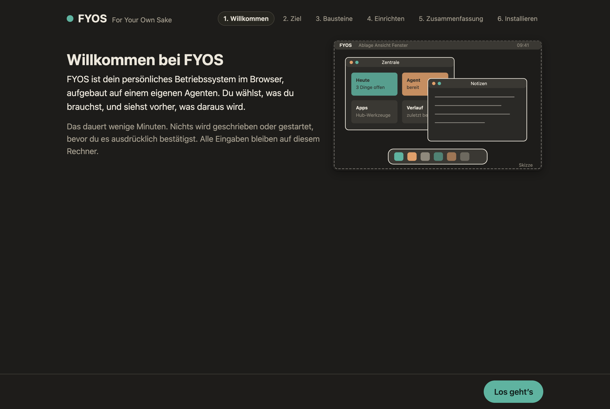
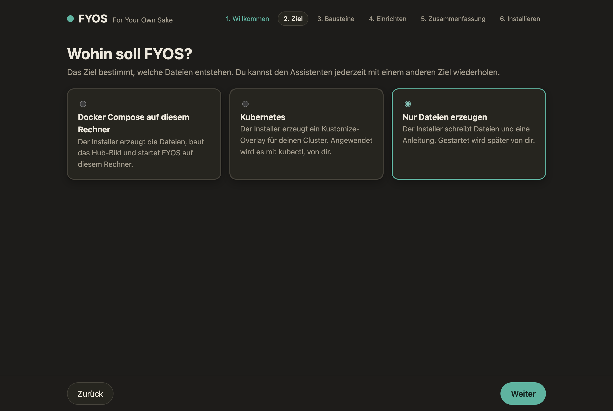
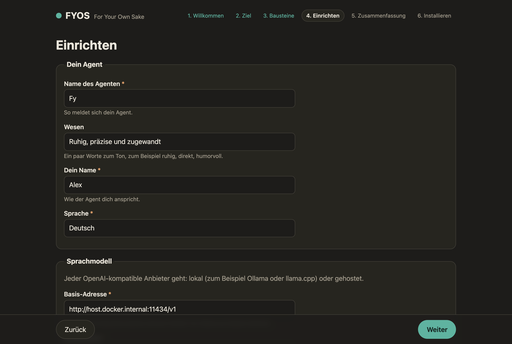
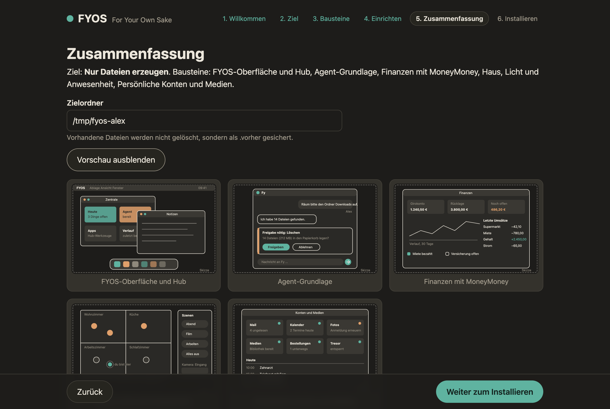
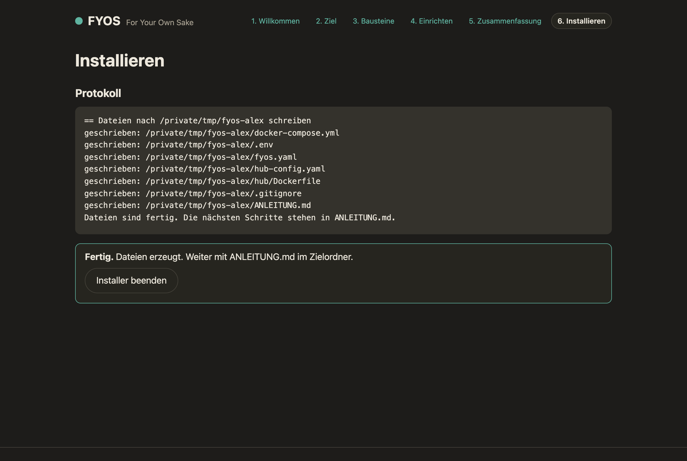

# FYOS-Installer

Der Installer der Distribution **FYOS — For Your Own Sake**: eine Auswahl von Bausteinen, die auf dem Bildschirm
erklärt (mit Bildern), was daraus wird, und danach die Auslieferung erzeugt (Docker Compose oder Kubernetes).

```sh
pip install ./installer                 # Python 3.11 oder neuer
pip install "./installer[tui]"          # optional: Textoberfläche
pip install "./installer[tui,bilder]"   # optional: Screenshots (PNG/JPG) im Terminal
```

## Drei Bedienarten

### 1. Web-Assistent (Standard)

```sh
fyos-install
```

Startet einen Server nur auf `127.0.0.1` (zufälliger Port, Zugangstoken im Link) und öffnet den Browser. Läuft
offline, ohne CDN. Schritte: Willkommen, Ziel, Bausteine, Einrichten, Zusammenfassung, Installieren (Live-Protokoll).
Bedienung per Tastatur: Tab, Leertaste (Baustein wählen), Pfeiltasten in der Bildgalerie, Enter für Weiter.
`--kein-browser` gibt nur den Link aus, `--port N` legt den Port fest.

| Schritt | Bild |
|---|---|
| Willkommen |  |
| Ziel wählen |  |
| Bausteine mit Bildgalerie und »Was daraus wird« |  |
| Einrichten (Agent, Modell, Felder der Bausteine) |  |
| Zusammenfassung mit Vorschau, was entsteht |  |
| Installieren mit Live-Protokoll (hier Ziel »Nur Dateien«) |  |

Die Bilder in der Galerie der Bausteine sind Skizzen unter `fyos_installer/bilder/` (zum Beispiel
[kern-1.svg](fyos_installer/bilder/kern-1.svg), [agent-1.svg](fyos_installer/bilder/agent-1.svg),
[finanzen-1.svg](fyos_installer/bilder/finanzen-1.svg), [haus-1.svg](fyos_installer/bilder/haus-1.svg));
liegt daneben eine `.png` gleichen Namens, zeigt der Installer sie.

API (alle Aufrufe brauchen das Token): `GET /api/katalog`, `POST /api/plan`, `POST /api/installieren`,
`GET /api/protokoll` (Server-Sent Events).

### 2. Textoberfläche

```sh
fyos-install --tui
```

Dieselben Schritte mit Textual. Tasten: `n` weiter, `b` zurück, `q` beenden (`Strg+n` / `Strg+b` auch im Textfeld).
PNG/JPG-Bilder zeigt `textual-image` (Extra `bilder`), SVG-Skizzen erscheinen als Textbeschreibung mit Pfad.
Ohne Textual erscheint eine Meldung mit dem passenden `pip`-Befehl.

### 3. Ohne Oberfläche

```sh
fyos-install --auswahl kern,agent,finanzen --ziel compose --antworten antworten.yaml --verzeichnis ./fyos --trocken
fyos-install --auswahl kern,agent --ziel k8s --verzeichnis ./fyos-k8s --ja
```

`--ziel compose|k8s|dateien`; `--trocken` zeigt Dateien und Befehle und schreibt nichts; `--ja` fragt nicht nach;
ohne Terminal ist `--ja` Pflicht. Abhängigkeiten und Pflichtbausteine werden ergänzt. `--liste` zeigt den Katalog.
`--abnahme ADRESSE` führt nur die [Abnahme](#abnahme) gegen eine laufende Installation aus.

Rückgabewerte: `0` gut, `1` Installation oder Start gescheitert, `2` falsche Eingabe, `3` FYOS läuft, aber die
Abnahme ist nicht bestanden.

`antworten.yaml` (alles optional, Vorgaben siehe `erzeugen.py`):

```yaml
persona: {agent_name: Fy, wesen: ruhig und direkt, besitzer_name: Alex, sprache: Deutsch}
modell: {basis_url: "http://host.docker.internal:11434/v1", name: "mein-modell", schluessel: ""}
felder:
  kern: {port: 8080}
  haus: {ha_url: "http://homeassistant.example.com:8123", ha_token: "…"}
optionen: {plugin_quelle: "https://git.example.com/fyos", namespace: fyos}
```

Vorgaben aus der Umgebung:

| Variable | Wirkung |
|---|---|
| `FYOS_PAKETINDEX` | PyPI-kompatibler Index (zum Beispiel `https://git.example.com/api/packages/org/pypi/simple`); Plugins werden per Paketname installiert, der Index geht als `--build-arg FYOS_INDEX_URL` ins Hub-Dockerfile und steht dort vor PyPI |
| `FYOS_PLUGIN_QUELLE` | Git-Adresse der Plugin-Repos (`optionen.bezug: git`) |
| `FYOS_REGISTRY` | zum Beispiel `registry.example.com/org`; ergibt `<reg>/fyos-os/web:main`, `<reg>/fyos-os/hub:main`, `<reg>/fyos-agent/openclaw:main` |
| `FYOS_BILD_TAG` | Tag aller Bilder statt `v<Version>` (ohne `FYOS_REGISTRY`) bzw. `main` (mit), zum Beispiel `latest` |

Ohne `FYOS_REGISTRY` kommen Oberfläche, Hub und Agent-Grundlage aus den veröffentlichten Bildern unter
`ghcr.io/sirfyyn`, im Stand der Installer-Version (Installer 0.1.1 → Tag `v0.1.1`). Nur das Hub-Bild mit den gewählten <!-- sauber: ok -->
Plugins (`hub_bild_k8s`, Ziel Kubernetes) baut man selbst; es braucht eine eigene Registry, sonst weist der Plan darauf
hin. `optionen.bezug` ist `index` (Vorgabe) oder `git`; ist nur eine Plugin-Quelle gesetzt, gilt `git`. Die Bilder
(`bild_web`, `hub_bild`, `bild_agent`, `hub_bild_k8s`) sind in den Antworten und im Assistenten editierbar.

#### Warum uv, und warum der eigene Index Vorrang hat

Das erzeugte Hub-Dockerfile installiert die Plugin-Pakete mit `uv pip install` statt mit `pip`. Der eigene Paketindex
kommt als Bau-Argument `FYOS_INDEX_URL` (Compose reicht dafür `FYOS_PAKETINDEX` aus der `.env` durch, bei Kubernetes
steht es im Bau-Befehl) und steht per `--index` vor PyPI. Dazu steht `--index-strategy first-index` ausdrücklich im
Befehl: uv nimmt ein Paket nur aus dem ersten Index, der es führt. Ein Paket gleichen Namens auf PyPI kann das eigene
deshalb nicht verdrängen (Dependency Confusion). Mit `pip --extra-index-url` nähme pip dagegen die höchste Version aus
allen Indizes, und ein fremdes Paket mit höherer Versionsnummer gewänne. `unsafe-best-match` gehört nirgends in den
Befehl; ein Test hält das fest. Die Version von uv ist fest gewählt (`UV_BILD` in `fyos_installer/erzeugen.py`, dieselbe
wie im Hub-Bild der Distribution; ein Test hält beide gleich). Der frühere Bau-Argument-Name `PIP_EXTRA_INDEX_URL` entfällt:
uv liest ihn nicht. Ein alter Bau-Befehl mit diesem Namen lässt den eigenen Index deshalb aus (Docker warnt vor dem nicht
verbrauchten Bau-Argument); Pakete, die nur im eigenen Index liegen, findet der Bau dann nicht und bricht ab. Ist der
eigene Index selbst nicht erreichbar, bricht uv ebenfalls ab, statt auf PyPI auszuweichen.

## Was entsteht

Compose (`compose`, `dateien`): `docker-compose.yml` (Hub mit `build: ./hub`), `.env` (Geheimnisse, Rechte 0600),
`fyos.yaml` (Persona), `hub-config.yaml` (Format des Hubs, Plugins per Entry-Point-Name), `hub/Dockerfile`
(`FROM <Hub-Bild>` plus `uv pip install` der Plugin-Quellen), `.gitignore`, `ANLEITUNG.md`. Bei `compose` folgen
`docker compose build`, `up -d` und eine Gesundheitsprüfung (web `/`, hub `/health`).

Kubernetes (`k8s`): Kustomize-Overlay mit `kustomization.yaml` (Basis `deploy/k8s/base` als Pfad oder Git-URL,
`optionen.k8s_basis`), ConfigMaps für `fyos.yaml` und Hub-Konfiguration, `secrets.yaml` (0600) und
`secrets.example.yaml`, `hub/Dockerfile`, `ANLEITUNG.md`. Angewendet wird mit `kubectl`, vom Nutzer. Vorhandene
Dateien werden als `<name>.vorher` gesichert.

## Reifegrad

FYOS hat vier Schichten mit je drei Stufen. Vor dem Schreiben zeigt der Installer, auf welcher Stufe jede Schicht mit
der gewählten Konfiguration steht, woran man die Stufe im laufenden System erkennt und was die nächste Stufe wäre
(Zusammenfassung im Web-Assistenten und in der Textoberfläche; ohne Oberfläche nach dem Zielordner, auch bei `--trocken`).

| Schicht | Stufe 1 | Stufe 2 | Stufe 3 |
|---|---|---|---|
| Gedächtnis | Persona | Wissen aus Bausteinen | Verlauf und Vorgänge |
| Agent | Chat | Werkzeuge | Vorgänge |
| Takte | Von Hand | Routinen | Routinen mit Grenzen |
| Oberfläche | Desktop | Apps | Zentrale |

Zu jeder Stufe gehört ein Satz »woran erkennbar« (`LEITER` in `fyos_installer/reife.py`), etwas, das man im laufenden
System nachsehen kann: zum Beispiel für Takte Stufe 3, dass `mcp.zeitplan` zu jeder Routine Tageslimit und Zeitfenster
samt Laufprotokoll zeigt.

Herleitung: Jede Schicht beginnt auf Stufe 1, das leisten Kern und Agent (beide Pflicht). Ein Baustein hebt sie über
`reife` in seinem Katalogeintrag; es zählt die höchste Stufe unter den gewählten Bausteinen. Für Takte kommt eine Regel
aus der erzeugten Hub-Konfiguration dazu: Trägt ein gewähltes Hub-Plugin `takt_grenzen` (Tageslimit und Zeitfenster der
Takte, `docs/ERWEITERN.md` 2.12), steht die Schicht auf Stufe 3. Das ist eine Auskunft über die Konfiguration, kein
Messwert: Ob die Dienste antworten, prüft die Gesundheitsprüfung, ob der Hub Verbotenes ablehnt, die Abnahme.

## Abnahme

Ein System, das läuft, ist noch nicht abgenommen. Die Abnahme stellt vier Anfragen an die Adresse der Shell (dort, wo
auch der Browser anklopft): eine erlaubte und drei verbotene. Die verbotenen muss FYOS ablehnen.

| Anfrage | Was geschieht | Erwartet |
|---|---|---|
| Gegenprobe | `POST /hub-api/app-call` für `werkstatt.suchen` | beantwortet (200, `ok`) |
| Probe 1 | `POST /hub-api/call` für `audit.stats`: der volle Aufruf-Endpunkt, den die Shell nicht durchreicht | abgelehnt (403 oder 404) |
| Probe 2 | `POST /hub-api/app-call` mit `Origin` einer fremden Webseite und `Sec-Fetch-Site: cross-site` | 403 mit `kind: fremde_herkunft` |
| Probe 3 | `POST /hub-api/app-call` für `audit.stats`, ein Werkzeug ohne Oberfläche | 403 mit `kind: not_an_app` |

Nur Ablehnungen gelten. Antwortet FYOS auf eine verbotene Anfrage mit Erfolg, ist die Abnahme **nicht bestanden**; eine
andere Antwort als erwartet, eine Antwort ohne `kind` oder gar keine Antwort gilt als nicht nachgewiesen und besteht
ebenso nicht. Besteht die Gegenprobe nicht (falsche Adresse, Hub dahinter nicht erreichbar), sind die Ablehnungen nichts
wert; die Abnahme sagt das ausdrücklich. Die Anfragen sind harmlos, auch wenn die Ablehnung ausbleibt: Sie rufen nur
lesende Werkzeuge (`audit.stats` liefert Zahlen, `werkstatt.suchen` liest die Liste der Skripte), schreiben nichts und
lösen nichts aus. Sie brauchen weder Anmeldung noch Docker und laufen ohne Proxy und ohne Weiterleitungen zu folgen.

Beim Ziel Docker Compose läuft die Abnahme nach der Gesundheitsprüfung von selbst. Das Ergebnis steht im Protokoll und
in der Meldung des Assistenten; besteht sie nicht, heißt es »Gestartet, aber nicht abgenommen« (FYOS läuft trotzdem,
Rückgabewert `3`). Bei jedem anderen Ziel und zum Wiederholen:

```sh
fyos-install --abnahme http://localhost:8080      # 0 bestanden, 3 nicht bestanden, 2 unbrauchbare Adresse
```

Bei Kubernetes läuft dafür der Port-Forward aus der Anleitung (`kubectl -n <namespace> port-forward svc/web 8080:80`). Die
`ANLEITUNG.md` im Zielordner nennt den Abnahme-Befehl mit dem Port der Installation.

## Katalog

`fyos_installer/katalog.yaml`, Schema in `katalog.py`. Je Baustein: `id`, `titel`, `kurz`, `was_daraus_wird`
(Markdown, 3 bis 8 Sätze), `bilder` (Dateinamen unter `bilder/`, Schema `<id>-<n>.svg`; liegt daneben eine
`.png`, nimmt der Installer sie), `art` (`kern|agent|plugin`), `pflicht`, `abhaengig_von`, `voraussetzungen`,
`quelle` (`{paket: fyos-plugin-x, repo: fyos-plugin-x}`: Paketname im Index und Git-Repo-Name), `konfiguration`
(Felder mit `name` als Schlüssel, `titel` als Beschriftung (Pflicht), `typ` text|geheim|url|zahl|wahl,
`beschreibung`, `standard`, `pflicht`, optional `umgebung` und `optionen`),
`hub_plugins` (Einträge der Hub-Konfiguration: `name`, optional `config`, `secrets`, `enabled`),
optional `reife` (`{gedaechtnis|agent|takte|oberflaeche: 1 bis 3}`: auf welche Stufe der Baustein welche Schicht hebt,
siehe [Reifegrad](#reifegrad); fehlt eine Schicht, hebt er sie nicht).

Eigene Kataloge: ein Plugin-Paket bringt `fyos-katalog.yaml` mit (Entry-Point-Gruppe `fyos.katalog` mit Pfad,
Katalog oder Funktion, die eines davon liefert; oder die Datei im Paket). Fremde Kataloge: `--katalog URL|DATEI`.
Gleiche `id` in einem späteren Katalog ersetzt den früheren Eintrag; nennt der Ersatz kein `reife`, behält er das
des ersetzten Eintrags.

## Tests

```sh
pip install -e "installer[test]"
python -m pytest installer/tests -q
```

Docker wird nie gestartet; der Ablauf ist gemockt. Der Test `test_k8s_kustomize_baut` nutzt `kubectl kustomize`,
wenn vorhanden. Der Seitentest (`test_seiten.py`) braucht Node.

Die Abnahme prüft `test_abnahme.py` auf drei Ebenen: die Urteile mit einem Sender ohne Netz, `senden` gegen einen
lokalen Server (keine Weiterleitung, kein Proxy, nur http und https) und die ganze Kette gegen den echten Hub (Paket
`fyos-hub` im selben Python, sonst übersprungen) hinter einer Weiche, die aus `web/nginx/default.conf.template` gelesen
wird. Zu jeder Ablehnung gehört ein Sabotagetest: Lässt die Weiche den vollen Endpunkt durch, entfernt sie die
Herkunftsköpfe oder öffnet sie jedes Werkzeug, muss die Abnahme »durchgelassen« melden. Die Probewerkzeuge müssen im Hub
als `read` ausgezeichnet sein. `test_reife.py` hält die Leiter, die Herleitung und das Schema von `reife` fest, auch
diese Tabelle der Stufen.
